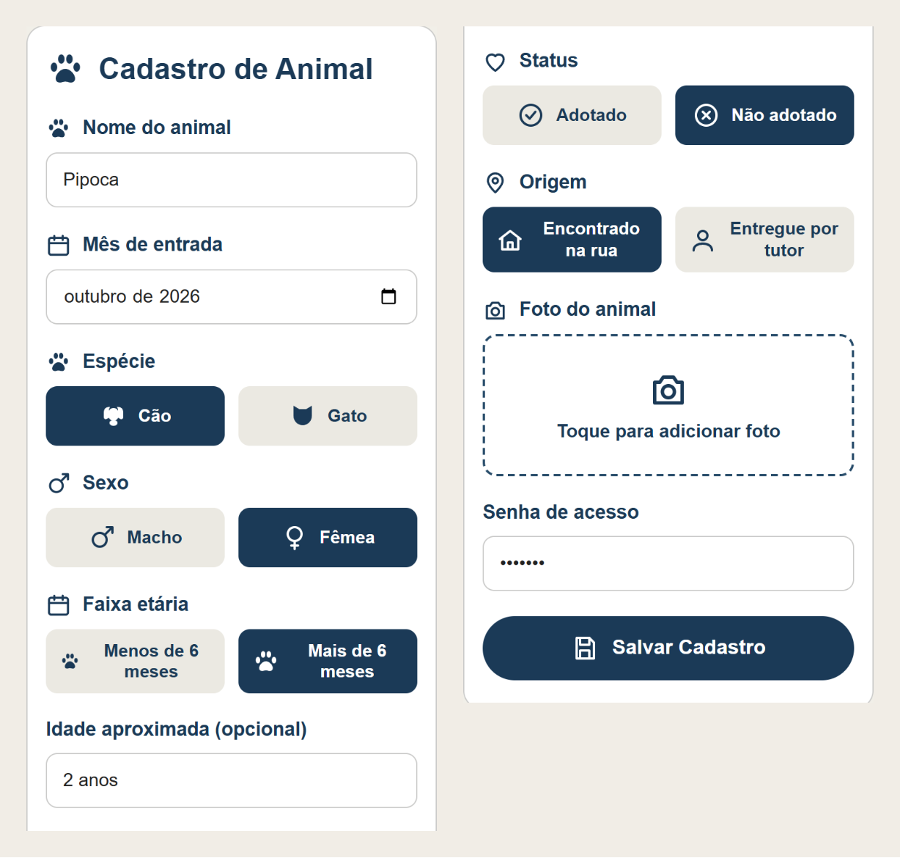
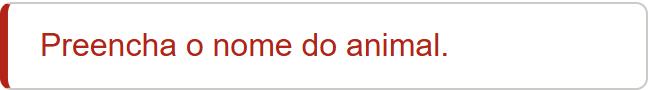
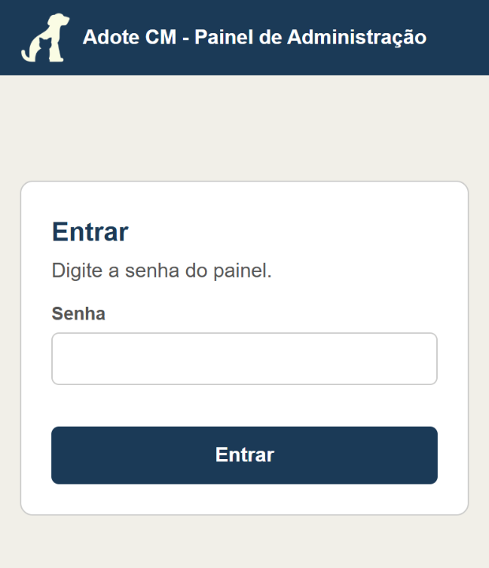
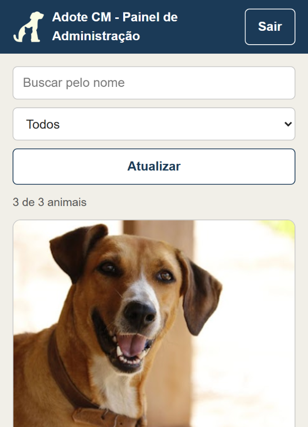
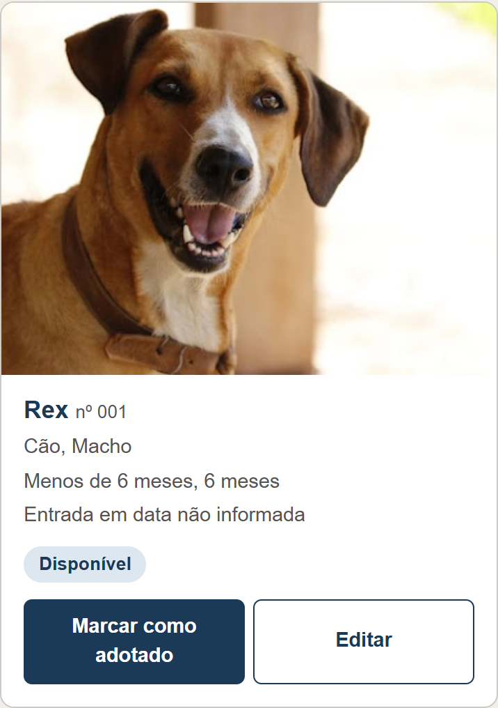
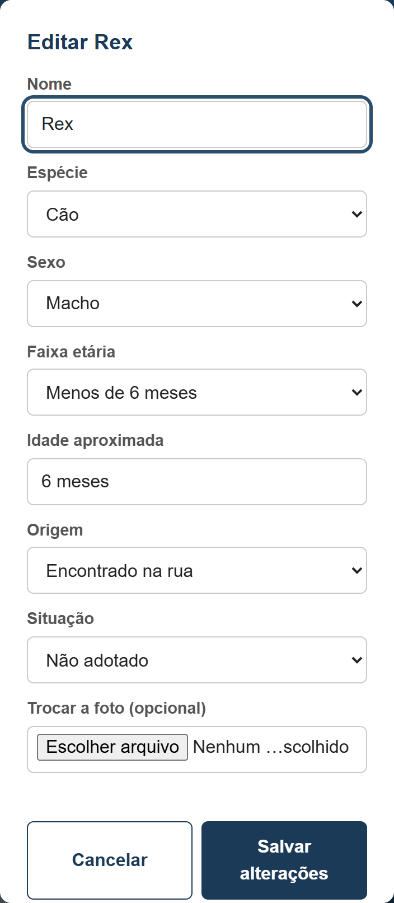
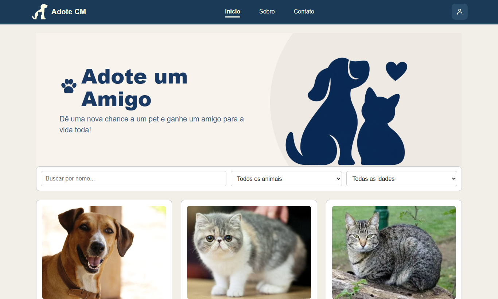
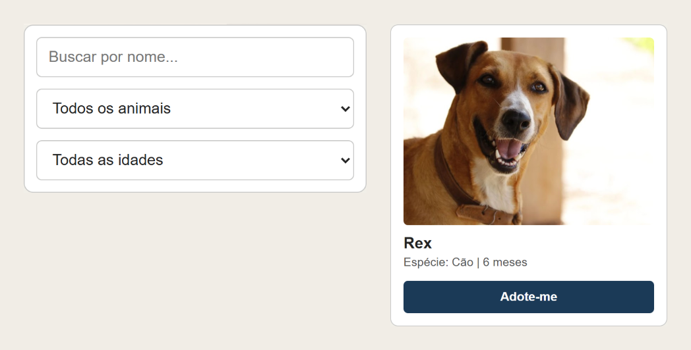

# Manual de uso do Adote CM

Elaborado por Pedro Gabriel · 13 de outubro de 2026

## Para começar

O sistema do Adote CM tem três páginas. Duas são só suas e pedem senha. A terceira é pública e mostra os animais para quem quer adotar.

| Página | Para que serve | Quem vê | Endereço |
| --- | --- | --- | --- |
| Cadastro de Animal | Registrar cada animal que chega à ONG | Só você, com senha | [hernandessn.github.io/adotecm/cadastro.html](https://hernandessn.github.io/adotecm/cadastro.html) |
| Painel de Administração | Ver todos os animais, marcar quem foi adotado e corrigir um cadastro | Só você, com senha | [hernandessn.github.io/adotecm/admin](https://hernandessn.github.io/adotecm/admin/) |
| Vitrine "Adote um Amigo" | Mostrar os animais que esperam um lar | Qualquer pessoa | [hernandessn.github.io/adotecm](https://hernandessn.github.io/adotecm/) |

Guarde os dois primeiros endereços nos favoritos do navegador, porque eles não aparecem em nenhum botão do site. Este manual fala em tocar, como no celular. No computador, é só clicar.

Tudo o que você cadastra fica guardado numa planilha do Google e aparece sozinho na vitrine. Você não precisa abrir a planilha: o cadastro e o painel fazem isso por você.

## Como cadastrar um animal

Faça um cadastro para cada animal que chega à ONG. Se ele estiver como "Não adotado", aparece na vitrine na próxima vez que alguém abrir a página.

1. Abra o endereço do cadastro: [hernandessn.github.io/adotecm/cadastro.html](https://hernandessn.github.io/adotecm/cadastro.html).
2. Escreva o **Nome do animal**.
3. Em **Mês de entrada**, escolha o mês em que ele chegou à ONG. Se não souber, pode deixar em branco.
4. Toque nas opções de **Espécie**, **Sexo** e **Faixa etária**. A opção escolhida fica azul-escura.
5. Se souber a idade, escreva em **Idade aproximada**, por exemplo "2 anos". Esse campo é opcional. Quando preenchido, é ele que aparece na vitrine no lugar da faixa etária.
6. Em **Status**, escolha **Não adotado** para o animal aparecer na vitrine. Escolha **Adotado** só se estiver registrando um animal que já foi adotado.
7. Em **Origem**, diga se ele foi **Encontrado na rua** ou **Entregue por tutor**.
8. Toque no quadro **Toque para adicionar foto** e tire a foto na hora ou escolha uma da galeria. A foto aparece logo abaixo para você conferir.
9. Digite a **Senha de acesso**.
10. Toque em **Salvar Cadastro** e espere. Enquanto envia, o botão mostra "Salvando...". Não toque de novo.

Quando dá certo, aparece em verde **"Animal cadastrado com sucesso!"**, com o número do animal. O formulário fica limpo para o próximo cadastro, e a senha continua preenchida.

### Quando aparece uma mensagem em vermelho

O formulário avisa o que falta antes de enviar. Nesse caso, nada foi salvo: corrija o que ele pediu e toque em **Salvar Cadastro** de novo.

| Mensagem | O que fazer |
| --- | --- |
| "Preencha o nome do animal.", "Escolha a espécie." e parecidas | Preencha o campo que a mensagem cita. |
| "Senha incorreta." | Confira a senha, letra por letra, e tente de novo. |
| "A foto é muito grande. Tente outra." | Escolha outra foto ou tire uma nova. |
| "Tipo de imagem não aceito. Use JPG ou PNG." | Use uma foto comum da galeria ou da câmera. |
| "Não conseguimos confirmar o cadastro. Confira a lista antes de tentar de novo." | **Não salve de novo ainda.** O cadastro pode ter sido gravado. Abra o painel e procure o animal pelo nome. Só cadastre de novo se ele não estiver lá, para não ficar repetido. |

## Como marcar um animal como adotado

Quem marca a adoção é o Painel de Administração. Ele mostra todos os animais, inclusive os já adotados, e também serve para corrigir um cadastro.

### Entrar no painel

1. Abra o endereço do painel: [hernandessn.github.io/adotecm/admin](https://hernandessn.github.io/adotecm/admin/).
2. Digite a senha do painel e toque em **Entrar**.

Se aparecer "Senha incorreta.", confira a senha e tente de novo. Se aparecer "Não deu para conectar", verifique a internet.

O painel lembra a senha enquanto a aba estiver aberta. Depois de fechar a aba ou tocar em **Sair**, ela é pedida de novo.

### Achar o animal

No alto do painel há três ferramentas:

- **Buscar pelo nome**: escreva parte do nome e a lista diminui na hora.
- **Lista de situação**: escolha **Todos**, **Disponíveis** ou **Adotados**.
- **Atualizar**: busca de novo os cadastros, útil se alguém cadastrou um animal em outro aparelho.

Logo abaixo, o painel mostra quantos animais estão na lista, por exemplo "3 de 3 animais". Cada animal aparece num cartão com foto, nome, número, espécie, sexo, idade e mês de entrada. Embaixo vem o selo **Disponível** ou **Adotado**.

### Marcar a adoção

1. No cartão do animal, toque em **Marcar como adotado**.
2. Aparece a pergunta "Marcar [nome] como adotado? Ele sai da vitrine." Toque em **OK**.
3. Aparece o aviso "[nome] marcado como adotado." O selo muda para **Adotado** e o animal sai da vitrine.

Marcou o animal errado? Toque em **Desfazer adoção** no mesmo cartão e confirme com **OK**. Ele volta para a vitrine.

### Corrigir um cadastro

1. No cartão do animal, toque em **Editar**.
2. Corrija o que precisar: nome, espécie, sexo, faixa etária, idade, origem ou situação. Para trocar a foto, use **Trocar a foto (opcional)**.
3. Toque em **Salvar alterações**. Para sair sem mudar nada, toque em **Cancelar**.

O mês de entrada não aparece nessa janela, então não dá para corrigi-lo pelo painel.

Se aparecer "Não deu para confirmar a resposta", o painel já atualizou a lista sozinho. Confira se a mudança aparece no cartão e só repita se não aparecer. Se aparecer "Sessão expirada", digite a senha de novo.

## Como acessar a vitrine

A vitrine é a página pública do Adote CM, e é esse o endereço para divulgar nas redes sociais: [hernandessn.github.io/adotecm](https://hernandessn.github.io/adotecm/). Ela mostra só os animais marcados como "Não adotado".

Quem visita a página pode:

- buscar um animal pelo nome;
- filtrar por espécie: **Cão** ou **Gato**;
- filtrar por idade: **Menos de 6 meses** ou **Mais de 6 meses**.

Cada animal aparece num cartão com foto, nome, espécie, idade e o botão **Adote-me**. No celular, os cartões ficam um embaixo do outro.

### Conferir se um cadastro novo apareceu

Abra a vitrine, ou recarregue a página se ela já estiver aberta, e procure o animal pelo nome. Se ele não aparecer, abra o painel e veja se a situação dele está como **Disponível**.

| Mensagem na vitrine | O que significa |
| --- | --- |
| "Carregando animais..." | A página está buscando os cadastros. Espere alguns segundos. |
| "Não foi possível carregar os animais" | A busca falhou. Toque em **Tentar de novo**. |
| "Nenhum animal disponível no momento" | Nenhum animal está como "Não adotado" no momento. |
| "Nenhum animal encontrado com esses filtros" | A busca ou os filtros não acharam ninguém. Apague a busca ou volte os filtros para "Todos". |

## Dicas e cuidados

### Para a foto ficar boa na vitrine

- Tire a foto com o celular deitado. A vitrine mostra as fotos na horizontal e corta o que sobra nas bordas.
- Deixe o animal no centro, ocupando boa parte da foto.
- Prefira a luz do dia e um fundo limpo.
- Um animal sem foto aparece na vitrine com um quadro cinza escrito "Sem foto". Dá para colocar a foto depois, pelo botão **Editar** do painel.

### Cuidados

- Use sempre o cadastro e o painel, e não altere a planilha à mão. As páginas só aceitam as opções certas. Na planilha, um erro de digitação pode tirar um animal da vitrine.
- Não compartilhe a senha. Se alguém que sabia a senha sair da ONG, peça à equipe para trocá-la.
